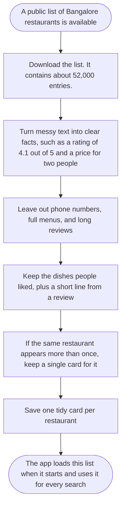
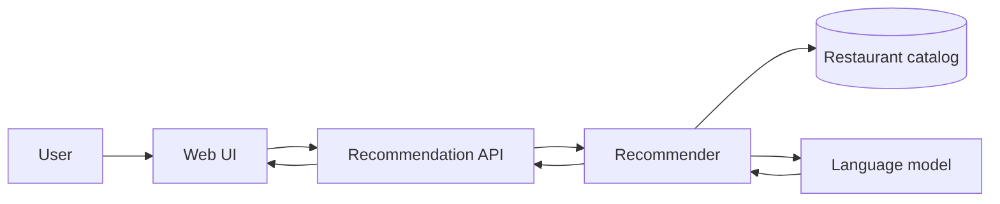
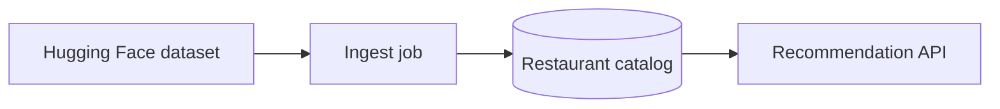
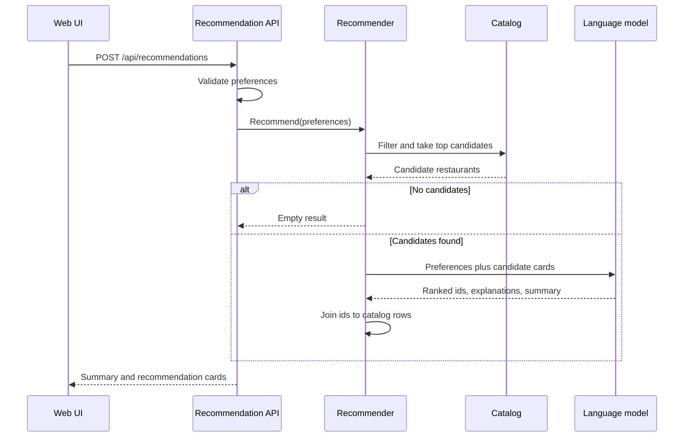

# Architecture

## AI-Powered Restaurant Recommendation System

This document is the architecture for the system described in [problemstatement.md](problemstatement.md). It defines how restaurant data, user preferences, and the language model fit together, and the contracts each part of the application follows.

The system recommends restaurants from the Zomato Bangalore dataset. Structured filters narrow the catalog to restaurants that match location, budget, cuisine, and minimum rating. A language model then ranks that short list, explains each pick against the user’s extra preferences, and writes a short summary. Names, ratings, cuisines, and prices shown to the user always come from the catalog.

## How it works, in plain language

Two things happen. First the app prepares a tidy list of Bangalore restaurants. Then, each time a person asks for ideas, the app narrows that list and asks an AI helper to rank the matches and explain them.

Rounded boxes are the start or the finish. Rectangles are something the app does. Diamonds are yes-or-no questions.

### Preparing the restaurant list

This runs before anyone uses the app, and again when the restaurant data is refreshed.



Each card holds the name, neighborhood, cuisines, price for two, rating, how many people rated it, the kind of place it is, whether it takes online orders or table bookings, and a short review note.

If this list cannot be loaded, the app does not start. People are never shown a blank catalog by mistake.

### Asking for recommendations

This runs every time someone submits the form.

The form asks for:

| What they enter | Required | How it is used |
| --- | --- | --- |
| Neighborhood, or all of Bangalore | Yes | Limits the search to that area |
| Budget: low, medium, or high | No | Low is 500 rupees or less for two, medium is 501 to 1,000, high is above 1,000 |
| Cuisine, such as Italian or Chinese | No | Keeps places that serve that cuisine |
| Minimum rating, from 0 to 5 | No | Keeps places at or above that score |
| Extra wishes, such as family-friendly or quick service | No | Helps the AI explain and order the results. It does not remove restaurants |

```mermaid
flowchart TD
    open(["Someone opens the recommendation page"])
    open --> enter["They fill in the form and submit it"]
    enter --> neighborhood{"Did they choose a neighborhood, or all of Bangalore?"}
    neighborhood -->|No| askArea["The page asks them to choose a neighborhood"]
    askArea --> enter
    neighborhood -->|Yes| valid{"Are the other answers usable?"}
    valid -->|No| askFix["The page points out what to correct, such as an unclear budget or a rating above 5"]
    askFix --> enter
    valid -->|Yes| startList["Start from the tidy restaurant list"]
    startList --> areaChoice{"Did they pick one neighborhood?"}
    areaChoice -->|One neighborhood| byArea["Keep restaurants in that neighborhood"]
    areaChoice -->|All of Bangalore| byCity["Keep restaurants across Bangalore"]
    byArea --> cuisineAsk
    byCity --> cuisineAsk
    cuisineAsk{"Did they name a cuisine?"}
    cuisineAsk -->|Yes| byCuisine["Keep restaurants that serve that cuisine"]
    cuisineAsk -->|No| skipCuisine["Leave the cuisine open"]
    byCuisine --> ratingAsk
    skipCuisine --> ratingAsk
    ratingAsk{"Did they set a minimum rating?"}
    ratingAsk -->|Yes| byRating["Keep restaurants at or above that rating"]
    ratingAsk -->|No| skipRating["Leave the rating open"]
    byRating --> budgetAsk
    skipRating --> budgetAsk
    budgetAsk{"Did they set a budget?"}
    budgetAsk -->|Yes| byBudget["Keep restaurants in that price band"]
    budgetAsk -->|No| skipBudget["Leave the price open"]
    byBudget --> sortList
    skipBudget --> sortList
    sortList["Put higher ratings first. When the rating is the same, put the more widely rated restaurants first."]
    sortList --> top15["Keep the best 15. Only these restaurants can be recommended."]
    top15 --> anyLeft{"Is at least one restaurant left?"}
    anyLeft -->|No| none["Tell them nothing matched, and show the choices they made"]
    none --> tryAgain(["They can widen their choices and try again"])
    anyLeft -->|Yes| askAi["Send those restaurants, plus any extra wishes, to the AI helper"]
    askAi --> aiOk{"Did the AI return a clear ranking?"}
    aiOk -->|No| fallback["Show the best matches from the short list, and say a written reason is unavailable"]
    fallback --> cards(["They see the restaurant cards"])
    aiOk -->|Yes| trusted["Ignore any place the AI mentions that was not on the short list"]
    trusted --> facts["Copy the name, cuisine, rating, and price from the restaurant list"]
    facts --> reasons["Add the AI's short summary and a reason for each pick"]
    reasons --> showTop["Show the top results, best match first. The usual number is 5."]
    showTop --> cards
```



What the person sees on each card is the restaurant name, cuisine, rating, estimated cost for two, neighborhood, and a short explanation of why it fits. The name, rating, cuisine, and price always come from the restaurant list. The AI writes the ranking, the reason, and a one-paragraph summary. It cannot invent a restaurant or change a price.

When nothing matches, the AI is not asked. When the AI is slow or its answer cannot be read, the person still sees the best matching restaurants, without the written reasons.

## Architecture style

The charts above follow the same two paths in everyday language. The diagrams below name the software parts that carry out those steps.

The application is a single web service with an offline data build.

| Path | What runs | When |
| --- | --- | --- |
| Ingest | Download the Hugging Face dataset, clean it, and write a compact catalog | On demand, before the API serves traffic, and again when the dataset is refreshed |
| Request | Validate preferences, filter the catalog, call the model, join model output back to catalog rows, return recommendations | Every recommendation request |

Four modules own the work. They call each other in one direction: the interface calls the API, the API calls the recommender, and the recommender reads the catalog and the model client.



Ingest sits beside the request path and only writes the catalog.



## Runtime

| Piece | Choice | Responsibility |
| --- | --- | --- |
| Language | Python 3.11+ | Ingest, API, filtering, and the model client |
| API | FastAPI | HTTP interface, validation, and response assembly |
| Catalog | Parquet file, loaded into memory at startup | Clean restaurant rows used by every request |
| Model access | OpenAI-compatible chat API | Ranking, explanations, and the summary |
| UI | Small browser client served by the API | Preference form and result list |

One process is enough. The catalog has on the order of ten thousand restaurants after duplicate listings are merged, which fits in memory and makes filtering a local lookup. The language model is the only remote call on the request path.

Configuration lives in environment variables:

| Variable | Purpose |
| --- | --- |
| `LLM_BASE_URL` | Model API base URL |
| `LLM_API_KEY` | Model credential |
| `LLM_MODEL` | Model name |
| `LLM_TIMEOUT_SECONDS` | Request timeout, default 30 |
| `CATALOG_PATH` | Path to the processed Parquet file |
| `MAX_CANDIDATES` | Rows sent to the model after filtering, default 15 |
| `DEFAULT_LIMIT` | Recommendations returned, default 5 |

Budget cutoffs live in application config so they can change without a code change:

| Budget | Cost for two |
| --- | --- |
| low | ₹500 or less |
| medium | ₹501 to ₹1,000 |
| high | above ₹1,000 |

## Repository layout

```text
docs/
  problemstatement.md          # what the product must do
  architecture.md              # this document
app/
  main.py                      # process startup and router mounting
  api/
    routes.py                  # HTTP handlers
    schemas.py                 # request and response models
  catalog/
    models.py                  # Restaurant record
    store.py                   # load Parquet and answer filter queries
  recommender/
    filters.py                 # preference to candidate list
    prompt.py                  # candidate cards and instructions
    llm.py                     # model client and JSON parse
    service.py                 # filter, call model, join results
  ui/
    index.html                 # preference form and results
    app.js
    styles.css
scripts/
  ingest.py                    # Hugging Face download and catalog build
data/
  processed/
    restaurants.parquet        # generated catalog, not hand-edited
```

Raw dataset files stay out of the repository. Ingest reads them from the Hugging Face cache and writes only `restaurants.parquet`.

## Data architecture

### Source

Dataset: [`ManikaSaini/zomato-restaurant-recommendation`](https://huggingface.co/datasets/ManikaSaini/zomato-restaurant-recommendation).

| Fact | Value |
| --- | --- |
| Split | `train` |
| Rows | 51,717 listings |
| Raw size | about 574 MB |
| Coverage | Bangalore restaurant listings |
| Neighborhoods | 93 values in `location` |
| Listing areas | 30 values in `listed_in(city)` |
| Listing types | 7 values in `listed_in(type)` |

Source columns:

| Column | Use |
| --- | --- |
| `name` | Display name |
| `address` | Identity and display |
| `location` | Neighborhood filter |
| `cuisines` | Cuisine filter and display |
| `approx_cost(for two people)` | Budget filter and estimated cost |
| `rate` | Minimum-rating filter and display |
| `votes` | Tie-break when several restaurants share a rating |
| `rest_type` | Context for extra preferences such as quick service |
| `dish_liked` | Context for the explanation |
| `online_order` | Context flag |
| `book_table` | Context flag |
| `listed_in(type)` | Aggregated listing types after deduplication |
| `reviews_list` | Source of at most two short snippets, then discarded |
| `url` | Optional link back to the listing |
| `phone` | Dropped. It is not required for a recommendation |
| `menu_item` | Dropped. It is large and unused by the recommendation contract |

`reviews_list` and `menu_item` make the raw file large. A single review field can run past a megabyte. The catalog keeps two review snippets of at most 280 characters each and drops the rest.

### Cleaning rules

Ingest applies these rules in order:

1. Parse `rate` values shaped like `4.1/5` into a float from 0 to 5. Leave `NEW`, `-`, and blank values as missing ratings.
2. Parse `approx_cost(for two people)` by removing commas and converting to an integer rupee amount. Leave blank values as missing cost.
3. Split `cuisines`, `rest_type`, and `dish_liked` on commas, trim whitespace, and drop empty tokens.
4. Map `online_order` and `book_table` from `Yes` / `No` to booleans.
5. Repair broken text encoding in names and addresses where the source has mojibake.
6. From `reviews_list`, keep the first two review texts and cut each to 280 characters.
7. Merge duplicate listings. The same restaurant appears once per `listed_in(type)` and `listed_in(city)`. Group by normalized name plus normalized address.
8. On each merged restaurant, keep the highest `votes` row as the source of rating and cost, and union cuisines, rest types, dishes, and listing types.
9. Assign a stable `id` from a hash of the normalized name and address.
10. Write one row per restaurant to Parquet.

### Catalog record

| Field | Type | Meaning |
| --- | --- | --- |
| `id` | string | Stable restaurant id |
| `name` | string | Restaurant name |
| `address` | string | Street address |
| `location` | string | Neighborhood, such as Banashankari |
| `cuisines` | list of string | Cuisine tokens |
| `cost_for_two` | integer or null | Approximate cost for two people, in rupees |
| `rating` | float or null | Parsed rating on a 0–5 scale |
| `votes` | integer | Number of votes |
| `rest_types` | list of string | Such as Cafe or Quick Bites |
| `dishes_liked` | list of string | Popular dishes, capped at 12 |
| `online_order` | boolean | Accepts online orders |
| `book_table` | boolean | Accepts table booking |
| `listed_types` | list of string | Listing categories such as Buffet or Cafes |
| `review_snippets` | list of string | Up to two short review excerpts |
| `url` | string | Listing URL |

The API loads this file once at startup and serves filters from memory. A failed load stops the process so the API never answers with an empty catalog by accident. Restart the process after a new ingest.

## Request path



### 1. Collect preferences

The form collects the fields required by the problem statement.

| Field | Required | Rule |
| --- | --- | --- |
| `location` | yes | A neighborhood from the catalog, or `All Bangalore` |
| `budget` | no | `low`, `medium`, or `high` |
| `cuisine` | no | A cuisine token such as Italian or Chinese |
| `min_rating` | no | Number from 0 to 5 |
| `preferences` | no | Free text, such as family-friendly or quick service. Maximum 500 characters |
| `limit` | no | Integer from 1 to 10. Default 5 |

`location` is the only required field because the dataset is Bangalore-wide and an unfiltered query would hand the model thousands of rows. Budget, cuisine, and rating narrow that set further. Free-text preferences are soft: they go to the model and do not remove rows.

### 2. Filter the catalog

Filters are applied in this order. A missing optional preference skips that filter.

1. **Location.** Case-insensitive equality on `location`. `All Bangalore` skips this step.
2. **Cuisine.** Keep a restaurant when any cuisine token contains the requested cuisine, compared case-insensitively. `Italian` matches `Cafe, Mexican, Italian`.
3. **Minimum rating.** Keep rows whose `rating` is present and greater than or equal to `min_rating`. Rows with a missing rating drop out once a minimum is set.
4. **Budget.** Keep rows whose `cost_for_two` falls inside the selected band. Rows with a missing cost drop out once a budget is set.
5. **Sort.** Order by `rating` descending, then `votes` descending. Rows with a missing rating sort last when no minimum was requested.
6. **Cap.** Keep the first `MAX_CANDIDATES` rows. Those rows are the only restaurants the model is allowed to mention.

The cap keeps the prompt small and the ranking comparable. Fifteen candidates is enough for a top-five list and stays within a single model call.

When the filtered set is empty, the recommender returns an empty result and does not call the model. The response names which filters were applied so the UI can ask the user to widen them.

### 3. Prompt the model

Each candidate is rendered as a compact card: id, name, location, cuisines, rest types, cost, rating, votes, online order, table booking, liked dishes, and the short review snippets.

The instruction to the model has four parts:

- Rank only the supplied candidate ids.
- Use the free-text preferences, rest type, dishes, booking flags, and review snippets when explaining a pick.
- Return at most `limit` restaurants, best match first.
- Respond with JSON matching the schema below.

```json
{
  "summary": "Two Italian cafes in Banashankari fit a medium budget and sit above 4.0.",
  "recommendations": [
    {
      "id": "8f3a1c",
      "rank": 1,
      "explanation": "Onesta is rated 4.6, serves Italian and pizza, and costs about ₹600 for two."
    }
  ]
}
```

The model client requests JSON output, parses it, and checks every id against the candidate set. Ranks are renumbered from 1 after invalid ids are dropped. If the model returns fewer usable items than `limit`, the service fills the remainder from the candidate list in catalog order and marks those explanations as unavailable.

### 4. Assemble the response

Display fields are copied from the catalog row for that id. The model contributes `rank`, `explanation`, and `summary` only. A model cannot change a rating or invent a restaurant that failed the filters.

```json
{
  "summary": "Two Italian cafes in Banashankari fit a medium budget and sit above 4.0.",
  "applied_filters": {
    "location": "Banashankari",
    "budget": "medium",
    "cuisine": "Italian",
    "min_rating": 4.0,
    "preferences": "family-friendly"
  },
  "candidate_count": 6,
  "recommendations": [
    {
      "rank": 1,
      "id": "8f3a1c",
      "name": "Onesta",
      "location": "Banashankari",
      "cuisines": ["Pizza", "Cafe", "Italian"],
      "rating": 4.6,
      "votes": 2556,
      "cost_for_two": 600,
      "explanation": "Onesta is rated 4.6, serves Italian and pizza, and costs about ₹600 for two."
    }
  ]
}
```

### 5. Present the results

The page has two regions.

**Preference form.** Location is a dropdown filled from `GET /api/locations`, with `All Bangalore` first. Cuisine is a text field with suggestions from `GET /api/cuisines`. Budget is a three-way choice. Minimum rating is a numeric input. Extra preferences are a text area. Submit calls `POST /api/recommendations` and shows a loading state until the response arrives.

**Result list.** A summary paragraph sits above the cards. Each card shows restaurant name, cuisine, rating, estimated cost for two, neighborhood, and the explanation. The list is ordered by `rank`.

Empty and failure states:

| Situation | What the user sees |
| --- | --- |
| Filters match nothing | A message that no restaurants matched, plus the filters that were applied |
| Model timeout or invalid JSON | The top catalog matches, with a note that explanations are unavailable |
| Catalog missing at startup | The API does not start; the UI shows that the service is unavailable |

## HTTP API

| Method | Path | Purpose |
| --- | --- | --- |
| `GET` | `/api/health` | Process is up and the catalog row count is non-zero |
| `GET` | `/api/locations` | Sorted neighborhood names |
| `GET` | `/api/cuisines` | Cuisine tokens with restaurant counts, most common first |
| `POST` | `/api/recommendations` | Filter, rank, and explain |

`POST /api/recommendations` returns 200 with the response body above, including the empty-candidate case (`candidate_count` 0 and an empty `recommendations` array). Invalid bodies return 422 with field errors. A model failure that cannot be filled from the catalog returns 503.

`GET /api/locations` and `GET /api/cuisines` exist so the form offers real values from the catalog. Both are derived at startup from the in-memory table.

## Failure behavior

| Failure | Response |
| --- | --- |
| Unknown budget or rating outside 0–5 | 422, no model call |
| Location that is not in the catalog and is not `All Bangalore` | 422 |
| Zero candidates | 200 with an empty list |
| Model timeout, HTTP error, or unparseable output | 200 with catalog-ordered candidates and empty explanations, when candidates exist |
| Model returns ids outside the candidate set | Those ids are discarded |
| Catalog file missing or unreadable | Process exits on startup |

Facts on a card stay aligned with the catalog in every failure mode. The fallback list is the same candidate list the model would have ranked, already sorted by rating and votes.

## Modules

### `scripts/ingest.py`

Reads the Hugging Face `train` split, applies the cleaning rules, and writes `data/processed/restaurants.parquet`. It prints row counts for raw listings, dropped rows, and unique restaurants. Re-running it replaces the catalog file.

### `app/catalog/store.py`

Loads Parquet into a list of `Restaurant` records and builds indexes for locations and cuisines. `filter(preferences)` runs the six filter steps and returns at most `MAX_CANDIDATES` records. It does not call the model.

### `app/recommender/service.py`

Owns one recommendation. It asks the catalog for candidates, builds the prompt, calls the model client, validates ids, and returns catalog-backed cards plus the summary. The API layer does not contain ranking logic.

### `app/recommender/llm.py`

Sends one chat completion, enforces the timeout, and parses JSON. It returns a typed result or a failure the service can turn into the catalog fallback. Provider details stay in this module so a model change is a configuration change.

### `app/api/routes.py`

Translates HTTP bodies into preference objects and recommendation results into JSON. It logs the location, candidate count, and model latency, and it does not log free-text preferences in full when they may contain personal details. A truncated length and a hash are enough for tracing.

### `app/ui`

Renders the form and the cards. It holds no restaurant data of its own. Refreshing the page clears the last result.

## Design constraints

These follow from the problem statement and the shape of the dataset.

- Filtering happens before the model call. The model ranks a prepared list.
- The model sees at most `MAX_CANDIDATES` restaurants per request.
- Phone numbers, full review dumps, and menu blobs are absent from the catalog and from the prompt.
- Rating, cost, cuisine, and name on a card are catalog values.
- Extra preferences influence explanations and ordering. They do not add restaurants the hard filters removed.
- The dataset describes Bangalore. The location control selects a neighborhood inside that city.

## Verification

The implementation is complete when the following hold:

| Check | Expected result |
| --- | --- |
| Ingest | Parquet file exists, ids are unique, ratings fall in 0–5, and costs are positive integers where present |
| Location filter | A Banashankari request returns only Banashankari restaurants |
| Cuisine and budget | Italian plus medium budget stays inside the cuisine match and the ₹501–₹1,000 band |
| Minimum rating | Every returned rating is at least the requested minimum |
| Model contract | Every recommended id was in the candidate list, and card facts match the catalog |
| Empty filters | A combination that matches nothing returns an empty list and does not call the model |
| UI | Submitting the form shows name, cuisine, rating, estimated cost, and an explanation for each top result |
