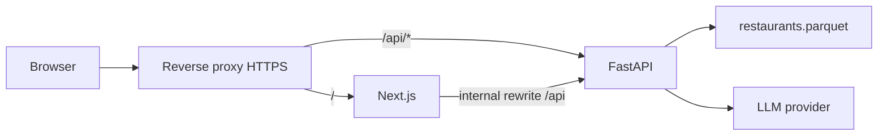

# Deployment plan

## AI-Powered Restaurant Recommendation System

**Free hosting (chosen path):** see [deploy-vercel-railway.md](deploy-vercel-railway.md)  
Frontend on **Vercel**, backend on **Railway**.

**Self-hosted Docker path:** use the files under [`deploy/`](../deploy/) (implemented below).

This plan deploys the finished stack:

| Piece | Role | Local default |
| --- | --- | --- |
| FastAPI (`app/`) | Catalog, filters, LLM ranking, `/api/*` | `http://127.0.0.1:8000` |
| Next.js (`web/`) | Primary UI (search, favorites, compare) | `http://localhost:3000` |
| Parquet catalog | `data/processed/restaurants.parquet` | Built by `scripts/ingest.py` |
| Groq (or compatible LLM) | Rank + explain | Via `.env` |

The static UI under `app/ui` can stay mounted on the API host as a fallback. Production traffic should go through the Next.js app.



## Recommended target: Docker Compose behind HTTPS

Use one VPS or cloud VM with Docker Compose and a reverse proxy (Caddy).

### Why this shape

- FastAPI and Next stay separate processes (matches the codebase).
- The browser talks to one public origin; `/api` is proxied to the API container.
- Secrets stay in environment variables, not in the image.
- The catalog is baked into the API image from `data/processed/restaurants.parquet`.

### Services

| Service | Image / build | Port (internal) | Notes |
| --- | --- | --- | --- |
| `api` | [`deploy/api.Dockerfile`](../deploy/api.Dockerfile) | `8000` | `uvicorn app.main:app --host 0.0.0.0 --port 8000` |
| `web` | [`deploy/web.Dockerfile`](../deploy/web.Dockerfile) | `3000` | `next start` after `next build` |
| `proxy` | Caddy | `80` / `443` | [`deploy/Caddyfile`](../deploy/Caddyfile) routes `/` → web, `/api` → api |

### Compose layout

```text
deploy/
  docker-compose.yml
  Caddyfile
  api.Dockerfile
  web.Dockerfile
  .env.example
```

**API image**

1. Install deps from `requirements-prod.txt` (no pytest).
2. Copy `app/`, `scripts/`, and pre-built `data/processed/restaurants.parquet`.
3. Start with uvicorn. Process exits if the Parquet file is missing.

**Web image**

1. `npm ci` in `web/`.
2. Build with `API_ORIGIN=http://api:8000` so Next rewrites `/api/*` to the API service.
3. `npm run start` listens on `0.0.0.0:3000`.

**Proxy routes**

| Public path | Upstream |
| --- | --- |
| `/api/*` | `api:8000` |
| `/*` | `web:3000` |

### Run Compose locally

From the repository root, ensure the catalog exists, then:

```powershell
python scripts\ingest.py
copy deploy\.env.example deploy\.env
# Edit deploy\.env and set LLM_API_KEY
docker compose -f deploy/docker-compose.yml --env-file deploy/.env up -d --build
```

Open [http://localhost/](http://localhost/) and [http://localhost/api/health](http://localhost/api/health).

For a public hostname, edit `deploy/Caddyfile` to use your domain instead of `:80` (Caddy will request certificates).

## Environment variables

### API

| Variable | Required | Purpose |
| --- | --- | --- |
| `LLM_BASE_URL` | Yes for live explanations | OpenAI-compatible base URL |
| `LLM_API_KEY` | Yes for live explanations | Provider key (never commit) |
| `LLM_MODEL` | Yes for live explanations | Model id |
| `LLM_TIMEOUT_SECONDS` | No | Default `30` |
| `CATALOG_PATH` | No | Default `data/processed/restaurants.parquet` |
| `MAX_CANDIDATES` | No | Default `15` |
| `DEFAULT_LIMIT` | No | Default `5` |
| `BUDGET_LOW_MAX` / `BUDGET_MEDIUM_MAX` | No | Budget bands |
| `CORS_ORIGINS` | No | Comma-separated browser origins; supports `https://*.vercel.app` |

Without an API key, recommendations still return catalog rows with fallback ordering and empty explanations.

### Web

| Variable | Required | Purpose |
| --- | --- | --- |
| `API_ORIGIN` | Yes | API base for Next rewrites (`http://api:8000` in Compose; Railway URL on Vercel) |

## Pre-deploy checklist

1. **Catalog present**  
   Run ingest and include `data/processed/restaurants.parquet` in the deploy artifact / git (raw CSV stays ignored).

   ```powershell
   .\.venv\Scripts\Activate.ps1
   python scripts\ingest.py
   ```

2. **Secrets**  
   Store `LLM_API_KEY` in Compose env / Railway / Vercel secrets. Keep `.env` and `APIKeys.txt` out of git.

3. **Health**  
   `GET /api/health` → `{ "status": "ok", "restaurants": <N> }` with `N > 0`.

4. **Smoke search**  
   `POST /api/recommendations` with Banashankari + Italian + medium + `min_rating` 4.

5. **UI**  
   Open `/`, search, shareable URL, favorites, compare.

6. **Tests (optional)**  
   ```powershell
   .\.venv\Scripts\python.exe -m pytest tests -q
   cd web
   npm run build
   ```

## Deployment steps (Compose path)

1. Provision a VM (2 vCPU / 4 GB RAM minimum).
2. Install Docker + Docker Compose.
3. Clone the repo (with Parquet present).
4. Copy `deploy/.env.example` → `deploy/.env` and set secrets.
5. Point DNS at the VM; update `Caddyfile` with the domain.
6. `docker compose -f deploy/docker-compose.yml --env-file deploy/.env up -d --build`.
7. Confirm TLS / HTTP on the public hostname.
8. Hit `/api/health` and the home page.
9. Run the smoke search.
10. Back up Parquet if you later switch to a volume mount.

## Alternative hosts

### Free PaaS (current choice)

See [deploy-vercel-railway.md](deploy-vercel-railway.md).

| App | Host |
| --- | --- |
| API | Railway |
| Web | Vercel |

### Single-process “API only”

Ship FastAPI + static `app/ui` only. Loses Next.js favorites / compare / shareable-URL UX.

## Operational notes

- **Restart after ingest.** Catalog loads at API process start.
- **LLM outages.** API returns 200 with rating order and `explanations_available: false`.
- **Ship Parquet only**, not the raw Zomato CSV.
- **Do not log raw preference text.**
- Favorites / compare / recent searches are browser `localStorage` only.

## Security checklist

- [ ] No API keys in git or images  
- [ ] HTTPS on the public hostname  
- [ ] Restrict SSH / dashboard access  
- [ ] CORS limited to real web origins if API is public  
- [ ] Rate-limit `/api/recommendations` at the proxy when public  
- [ ] Keep dependency updates on a schedule  

## Success criteria

1. `https://<your-domain>/` (or `http://localhost/`) loads Bangalore Bites.  
2. `/api/health` returns a non-zero restaurant count.  
3. Filtered search returns ranked cards (explanations when LLM key is set).  
4. Shareable URLs, favorites, and compare work.  
5. Secrets are not in the repository or public image layers.

## Out of scope

- Multi-region HA, managed databases, or auth / user accounts.  
- Migrating favorites to a server-side store.
