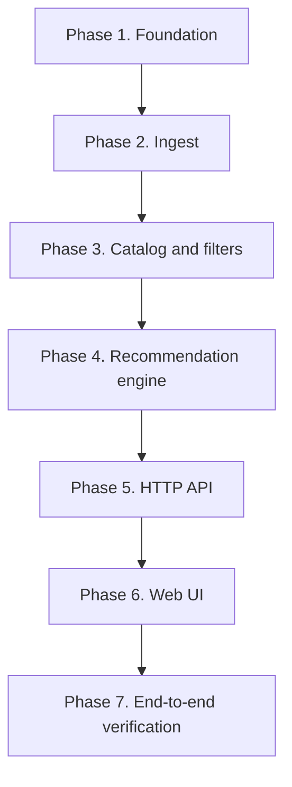

# Phase-wise implementation

## AI-Powered Restaurant Recommendation System

This plan builds the system described in [problemstatement.md](problemstatement.md) and [architecture.md](architecture.md). Complete the phases in order. Each phase leaves the project runnable at the level it claims, with tests for the behavior it adds.

The repository root is the folder that contains `docs/`. Phases add `app/`, `scripts/`, `tests/`, and `data/` beside `docs/`.



| Phase | Outcome | Model call |
| --- | --- | --- |
| 1. Foundation | Installable Python app, settings, empty service | No |
| 2. Ingest | `data/processed/restaurants.parquet` built from Hugging Face | No |
| 3. Catalog and filters | In-memory catalog that returns at most 15 matches | No |
| 4. Recommendation engine | Rank, explain, summarize, and fall back safely | Yes, behind a replaceable client |
| 5. HTTP API | Health, locations, cuisines, and recommendations | Yes, through the engine |
| 6. Web UI | Form and result cards a person can use | Yes, through the API |
| 7. Verification | The checks in the architecture pass on the running app | Yes, on the sample searches |

Shared rules for every phase:

- Displayed name, cuisine, rating, and price come from the catalog. The model supplies rank, explanation, and summary.
- Hard filters run before any model call. Extra wishes never add or remove rows.
- Phone numbers, full review text, and menus stay out of the catalog, the prompt, and the API response.
- A missing catalog stops process startup.
- Tests use small in-memory rows. The full dataset download belongs to the ingest script.

## Phase 1. Foundation

### Goal

Create the project skeleton, dependency list, and settings so later phases have one place to read configuration.

### Files

```text
requirements.txt
.env.example
.gitignore
app/__init__.py
app/main.py
app/config.py
app/api/__init__.py
app/catalog/__init__.py
app/recommender/__init__.py
tests/__init__.py
tests/test_config.py
```

### Dependencies

Pin compatible releases in `requirements.txt`:

| Package | Role |
| --- | --- |
| `fastapi` | HTTP API |
| `uvicorn` | Process server |
| `pydantic` | Request, response, and restaurant models |
| `pydantic-settings` | Environment settings |
| `pandas` | Ingest tables |
| `pyarrow` | Parquet read and write |
| `datasets` | Hugging Face download |
| `httpx` | Model API client |
| `ftfy` | Repair mojibake in names and addresses |
| `pytest` | Tests |

### Settings

`app/config.py` exposes a `Settings` object loaded from the environment.

| Setting | Default | Rule |
| --- | --- | --- |
| `llm_base_url` | empty | Required only when a live model call is made |
| `llm_api_key` | empty | Required only when a live model call is made |
| `llm_model` | empty | Required only when a live model call is made |
| `llm_timeout_seconds` | `30` | Positive number |
| `catalog_path` | `data/processed/restaurants.parquet` | Path relative to the repository root |
| `max_candidates` | `15` | Integer from 1 to 30 |
| `default_limit` | `5` | Integer from 1 to 10 |
| `budget_low_max` | `500` | Inclusive upper bound for low |
| `budget_medium_max` | `1000` | Inclusive upper bound for medium. High is every cost above this |

Budget bands derived from those two bounds:

| Budget | Cost for two |
| --- | --- |
| `low` | 1 through `budget_low_max` |
| `medium` | `budget_low_max + 1` through `budget_medium_max` |
| `high` | above `budget_medium_max` |

`ALL_BANGALORE = "All Bangalore"` lives next to settings and is the only location value that skips the neighborhood filter.

`.env.example` lists every variable with the defaults above and blank model credentials. `.gitignore` excludes `.env`, `.venv/`, `__pycache__/`, `.pytest_cache/`, `data/processed/*.parquet`, and the Hugging Face cache. The Parquet file is generated by ingest and is not committed.

### Startup shell

`app/main.py` creates a FastAPI app and a `GET /api/health` route that returns `{"status": "starting"}`. Phase 5 replaces this with the catalog check. The module must import without a catalog file and without model credentials so tests can collect.

### Steps

1. Create the virtual environment with Python 3.11 or newer and install `requirements.txt`.
2. Add the package folders and empty `__init__.py` files.
3. Implement `Settings` with the table above. Resolve `catalog_path` from the repository root, which is the parent of `app/`.
4. Add `budget_bounds(band)` that returns the inclusive integer range for `low` and `medium`, and an open upper end for `high`. An unknown band raises `ValueError`.
5. Write `tests/test_config.py` for the default bands: low is 1–500, medium is 501–1000, high starts at 1001. Assert an unknown band fails.
6. Confirm `python -c "from app.main import app"` succeeds from the repository root.

### Done when

- `pytest` passes.
- Settings read an override from the environment, including a changed `max_candidates`.
- The app imports with no `.env` file and no Parquet file.

## Phase 2. Ingest

### Goal

Turn the Hugging Face training split into one Parquet row per restaurant, using the cleaning rules in the architecture.

### Files

```text
app/catalog/cleaning.py
app/catalog/models.py
scripts/ingest.py
tests/test_cleaning.py
tests/fixtures/sample_listings.json
```

`scripts/ingest.py` is the job entry point. Parsing and merging live in `app/catalog/cleaning.py` so they can be tested without a network download.

### Restaurant record

`app/catalog/models.py` defines a `Restaurant` model with the catalog fields:

| Field | Type |
| --- | --- |
| `id` | string |
| `name` | string |
| `address` | string |
| `location` | string |
| `cuisines` | list of string |
| `cost_for_two` | integer or null |
| `rating` | float or null |
| `votes` | integer |
| `rest_types` | list of string |
| `dishes_liked` | list of string |
| `online_order` | boolean |
| `book_table` | boolean |
| `listed_types` | list of string |
| `review_snippets` | list of string |
| `url` | string |

### Cleaning functions

Implement these in order. Each function is pure.

**`parse_rating(value) -> float | None`**

- Accept `4.1/5`, `4.1 /5`, and a bare number from 0 to 5.
- Return `None` for `NEW`, `-`, blank, and any value outside 0–5.

**`parse_cost(value) -> int | None`**

- Remove commas and whitespace from values such as `1,200`.
- Return a positive integer.
- Return `None` for blank or non-numeric text.

**`parse_votes(value) -> int`**

- Accept an integer or a string with commas.
- Return `0` when the value is missing.

**`split_list(value) -> list[str]`**

- Split on commas, trim each token, drop empties, and keep first-seen order.
- Return an empty list for null.

**`parse_yes_no(value) -> bool`**

- `Yes` is true, compared case-insensitively. Every other value is false.

**`fix_text(value) -> str`**

- Run `ftfy.fix_text` so names such as a broken `Café` become readable text.
- Collapse internal whitespace and trim.

**`extract_snippets(value) -> list[str]`**

- The source field is a string shaped like a Python list of `('Rated 4.0', 'RATED\\n review text')` pairs.
- When the string is longer than 100,000 characters, read it with a bounded scan and do not parse the whole literal. Some rows carry more than a megabyte of reviews.
- Otherwise parse with `ast.literal_eval`. On failure, return an empty list.
- Keep the first two review bodies. Strip a leading `RATED` label, collapse whitespace, and cut each snippet to 280 characters.
- Return at most two strings.

**`normalize_identity(name, address) -> tuple[str, str]`**

- Fix text, casefold, and collapse whitespace for both fields.

**`make_id(name, address) -> str`**

- SHA-256 of the normalized name, a newline, and the normalized address.
- Use the first 12 hexadecimal characters. The same restaurant always receives the same id.

**`merge_listings(rows) -> Restaurant`**

- Group key is the normalized name plus the normalized address.
- Choose the listing with the highest `votes` as the source of `rating`, `cost_for_two`, `online_order`, `book_table`, `url`, and display name and address. On a tie, prefer the row that has a rating.
- Union `cuisines`, `rest_types`, `dishes_liked`, and `listed_types` in first-seen order.
- Cap `dishes_liked` at 12.
- Keep the first two review snippets encountered in the group.
- Drop a group whose name or address is empty after cleaning.

### Ingest script

`python scripts/ingest.py` does the following:

1. Load `ManikaSaini/zomato-restaurant-recommendation`, split `train`, through the `datasets` library.
2. Read these columns and ignore the rest: `url`, `address`, `name`, `online_order`, `book_table`, `rate`, `votes`, `location`, `rest_type`, `dish_liked`, `cuisines`, `approx_cost(for two people)`, `reviews_list`, `listed_in(type)`.
3. Leave `phone` and `menu_item` unread.
4. Clean each listing, merge duplicates, and write `data/processed/restaurants.parquet`.
5. Print raw listing count, merged restaurant count, and dropped count.
6. Replace the Parquet file on every run.

List columns are stored as Parquet lists. Null ratings and costs stay null.

### Fixture and tests

`tests/fixtures/sample_listings.json` holds a handful of raw rows that cover:

- A normal row: `4.1/5`, cost `800`, cuisines `North Indian, Chinese`, votes `775`.
- The same restaurant listed twice with different `listed_in(type)` values and different vote counts.
- `rate` of `NEW` and a blank cost.
- Cost `1,200` and votes written as `2,556`.
- A review string with two rated texts, plus a string that is not a list.
- A name with broken encoding.
- A row with a blank name.

`tests/test_cleaning.py` asserts:

- Ratings and costs parse as specified, including the rejected sentinels.
- The duplicate pair becomes one restaurant, keeps the higher-vote rating and cost, and unions cuisines and listing types.
- The id is stable across two merges of the same name and address.
- Snippets are at most two, and each is at most 280 characters.
- The blank-name row is dropped.
- A sample merged record contains no phone number and no menu text.

### Done when

- `pytest tests/test_cleaning.py` passes.
- `python scripts/ingest.py` finishes and writes `data/processed/restaurants.parquet`.
- The printed unique count is lower than 51,717.
- A second run overwrites the file and produces the same ids for the same names and addresses.
- Sampled ratings fall between 0 and 5, sampled costs are positive integers where present, and ids are unique.

Ingest needs a network connection the first time the dataset is downloaded. Later runs may use the Hugging Face cache.

## Phase 3. Catalog and filters

### Goal

Load the Parquet catalog once and answer the six filter steps from the architecture. This phase does not call the model.

### Files

```text
app/catalog/store.py
tests/test_filters.py
```

### Catalog store

`CatalogStore.load(path)` reads Parquet into a tuple of `Restaurant` objects.

At load time it builds:

- `locations`: sorted unique neighborhood names.
- `cuisines`: cuisine tokens paired with how many restaurants include them, most common first. A restaurant that lists a cuisine once contributes one to that count.

`filter(preferences)` applies these steps. A missing optional field skips that step.

1. **Location.** Case-insensitive equality on `location`. `All Bangalore` skips this step.
2. **Cuisine.** Keep a restaurant when any cuisine token contains the requested text, case-insensitively. `Italian` matches `Cafe, Mexican, Italian`.
3. **Minimum rating.** Keep rows whose rating is present and greater than or equal to the minimum. Missing ratings drop out once a minimum is set.
4. **Budget.** Keep rows whose `cost_for_two` falls inside the selected band. Missing costs drop out once a budget is set.
5. **Sort.** Rating descending, then votes descending. Missing ratings sort last when no minimum was requested.
6. **Cap.** Return the first `max_candidates` rows.

The method returns the matched rows and the count before the cap, so the API can report `candidate_count` as the number of restaurants that survived the filters. The list handed to the model is the capped list.

`CatalogStore` raises a clear error when the file is missing or unreadable. It does not create an empty store.

### Preference object

Add `Preferences` in `app/catalog/models.py`:

| Field | Type | Rule |
| --- | --- | --- |
| `location` | string | Required. Neighborhood or `All Bangalore` |
| `budget` | `low`, `medium`, `high`, or null | Optional |
| `cuisine` | string or null | Trimmed. Empty becomes null |
| `min_rating` | float or null | 0 through 5 |
| `preferences` | string or null | Trimmed, at most 500 characters |
| `limit` | integer | 1 through 10, default 5 |

Validation of unknown locations belongs to the API in Phase 5, where the live catalog is available. The filter itself treats an unknown neighborhood as a normal equality check and returns no rows.

### Tests

Build a store from eight restaurants in memory, including:

- Two in Banashankari, one Italian at 600 rupees rated 4.6 with many votes, one Chinese at 300 rupees rated 3.7.
- One Italian in another neighborhood at 700 rupees rated 4.2.
- One Banashankari restaurant with a null rating and a null cost.
- One restaurant whose cuisine string is `Cafe, Mexican, Italian`.
- Enough extra high-rated rows to prove the cap.

Assert:

- Banashankari plus Italian plus medium budget plus minimum 4.0 returns only rows in that neighborhood, with an Italian token, a cost from 501 to 1,000, and a rating of at least 4.0.
- `All Bangalore` with Italian includes the other neighborhood.
- A request with no cuisine, budget, or rating still filters by neighborhood and sorts by rating, then votes.
- Null rating and null cost remain when those filters are omitted, and drop out when the filters are set.
- The capped list length equals `max_candidates`, and `candidate_count` is the larger pre-cap total.
- An empty match returns an empty list and a candidate count of 0.

### Done when

- `pytest tests/test_filters.py` passes.
- A store loaded from the real Parquet file reports a non-zero restaurant count, a location list that includes known Bangalore neighborhoods, and cuisines ordered by frequency.
- Filtering that file for Banashankari returns only Banashankari restaurants.

## Phase 4. Recommendation engine

### Goal

Rank a filtered short list, explain each pick, and summarize the set. Join model output back to catalog rows. Survive a bad model response.

### Files

```text
app/recommender/prompt.py
app/recommender/llm.py
app/recommender/service.py
tests/test_prompt.py
tests/test_llm.py
tests/test_service.py
```

### Prompt

`build_messages(preferences, candidates)` returns a system message and a user message.

The system message states that:

- The reply is JSON with `summary` and `recommendations`.
- Each recommendation has `id`, `rank`, and `explanation`.
- Every id comes from the candidate list.
- The number of recommendations is at most `preferences.limit`.
- Explanations use the extra wishes, rest type, dishes, booking flags, and review snippets.
- The summary is one short paragraph.

The user message lists the preferences in plain sentences, then one compact block per candidate:

- id, name, neighborhood
- cuisines, rest types, liked dishes
- cost for two, rating, votes
- online order, table booking
- up to two review snippets

The block omits null cost and null rating rather than inventing a number. It includes no phone number and no menu.

`tests/test_prompt.py` checks that a fixture candidate's id and name appear, the extra wishes appear, and the words of a phone number from a decoy field do not appear.

### Model client

`app/recommender/llm.py` defines:

- `LlmClient.complete(messages) -> str`, which performs one chat completion.
- `OpenAiCompatibleClient`, which `POST`s to `{llm_base_url}/chat/completions` with `Authorization: Bearer {llm_api_key}`, the configured model, a temperature of 0.2, and the timeout from settings.
- The request asks for a JSON object when the endpoint accepts `response_format`. The parser still accepts a raw JSON string, and a string wrapped in a ```json fence.
- `parse_ranking(text) -> Ranking` producing `summary: str` and `items: list[{id, rank, explanation}]`. Invalid JSON raises `LlmError`.

`LlmError` covers timeout, HTTP failure, and unparseable output. The client logs the status and latency. It leaves the preference text out of the log.

Tests use a fake client that returns a canned string. One test points the HTTP client at a local mock only if that stays inside the test process. Live credentials are not required for `pytest`.

### Service

`RecommendationService.recommend(preferences, store, client)` :

1. Calls `store.filter(preferences)`.
2. When the candidate list is empty, returns a result with `candidate_count` 0, an empty recommendation list, and a summary that says nothing matched. It does not call the client.
3. Calls the client with the prompt for the capped candidates.
4. Drops any returned id that is not in the candidate list.
5. Sorts the remaining items by the model's rank and renumbers them from 1.
6. Copies name, location, cuisines, rating, votes, and `cost_for_two` from the catalog row. The explanation is the model's text, trimmed.
7. When the usable list is shorter than `limit` and shorter than the candidate list, appends further candidates in catalog order with an empty explanation until the list reaches `limit` or the candidates run out.
8. On `LlmError`, returns the candidates in catalog order, up to `limit`, with empty explanations and a summary that says written reasons are unavailable.
9. Sets `explanations_available` to false for the fallback and for any card that was filled in step 7.

Result fields:

| Field | Source |
| --- | --- |
| `summary` | Model, or the fallback sentence |
| `applied_filters` | The preferences that were set |
| `candidate_count` | Count before the cap |
| `explanations_available` | False when the model result was discarded |
| `recommendations` | Catalog facts plus rank and explanation |

### Tests

- Empty filter: the fake client is never called, and the result list is empty.
- Model returns a reversed ranking of known ids: the service order follows the model, and the rating on each card equals the catalog rating.
- Model returns an unknown id and one valid id: the unknown id is absent, and the shortfall is filled from the remaining candidates with an empty explanation.
- Client raises `LlmError`: the result follows catalog order, explanations are empty, and `explanations_available` is false.
- Prompt for a candidate with a null rating contains the name and omits a fabricated score.

### Done when

- The Phase 4 tests pass without a network call.
- A manual call with a real key, against the ingested catalog and a narrow Banashankari filter, returns only candidate ids and catalog prices. Record the command in a comment at the top of `scripts/ingest.py`'s module docstring only if it helps the operator. Keep the key in `.env`.

The manual call can wait until Phase 5 exposes it as HTTP. Phase 4 is complete when the service tests pass.

## Phase 5. HTTP API

### Goal

Expose the catalog and the recommendation service over HTTP, and refuse to start when the catalog cannot be loaded.

### Files

```text
app/api/schemas.py
app/api/routes.py
app/main.py
tests/test_api.py
```

### Lifespan

On startup, `app/main.py` loads `CatalogStore` from `settings.catalog_path`. A missing or unreadable file logs the path and exits the process with a non-zero status. The store and a `RecommendationService` are placed on `app.state`.

`GET /api/health` returns:

```json
{ "status": "ok", "restaurants": 12000 }
```

`restaurants` is the loaded count and is greater than zero.

### Routes

| Method | Path | Success |
| --- | --- | --- |
| `GET` | `/api/health` | 200 and the body above |
| `GET` | `/api/locations` | 200 and `{"locations": ["All Bangalore", "Banashankari", ...]}` with `All Bangalore` first and the rest sorted |
| `GET` | `/api/cuisines` | 200 and `{"cuisines": [{"name": "North Indian", "count": 1000}]}` most common first |
| `POST` | `/api/recommendations` | 200 and the recommendation body |

`POST /api/recommendations` accepts:

```json
{
  "location": "Banashankari",
  "budget": "medium",
  "cuisine": "Italian",
  "min_rating": 4.0,
  "preferences": "family-friendly",
  "limit": 5
}
```

`budget`, `cuisine`, `min_rating`, `preferences`, and `limit` may be omitted.

Validation, before the service runs:

| Condition | Status |
| --- | --- |
| Missing `location` | 422 |
| Location other than `All Bangalore` or a catalog neighborhood, compared case-insensitively | 422 |
| `budget` outside `low`, `medium`, `high` | 422 |
| `min_rating` outside 0–5 | 422 |
| `preferences` longer than 500 characters | 422 |
| `limit` outside 1–10 | 422 |

A valid body that matches nothing returns 200:

```json
{
  "summary": "No restaurants matched these choices.",
  "applied_filters": { "location": "Banashankari", "cuisine": "Italian" },
  "candidate_count": 0,
  "explanations_available": false,
  "recommendations": []
}
```

A valid body with candidates returns 200 with the service result. Each recommendation includes `rank`, `id`, `name`, `location`, `cuisines`, `rating`, `votes`, `cost_for_two`, and `explanation`.

When the model fails and the service has candidates, the route still returns 200 with the fallback list. Return 503 only when the model fails and the service cannot produce catalog rows, which in this design means the store itself failed. A zero-candidate success stays 200.

Logging for this route records location, candidate count, and model latency. It records the length and a hash of `preferences`, not the raw text.

### API tests

Use FastAPI's test client and a store built from the Phase 3 fixture. Inject a fake model client through `app.state`.

- Health reports the fixture count.
- Locations begin with `All Bangalore`.
- An unknown location returns 422 and the fake client is not called.
- A rating of 6 returns 422.
- A filter combination with no matches returns 200 and an empty list, and the fake client is not called.
- A matching request returns catalog ratings and costs, in the fake model's order.
- A client that raises `LlmError` returns 200 with empty explanations.

### Done when

- `pytest` passes.
- With the real Parquet file present, `uvicorn app.main:app --reload` starts and `/api/health` shows a non-zero count.
- Renaming the Parquet file and starting again exits the process.
- `POST /api/recommendations` with `{"location": "Banashankari", "cuisine": "Italian", "budget": "medium", "min_rating": 4}` returns cards whose facts exist in the catalog.

## Phase 6. Web UI

### Goal

Serve a single page where a person can enter preferences and read the top recommendations.

### Files

```text
app/ui/index.html
app/ui/app.js
app/ui/styles.css
```

Mount `app/ui` as static files in `app/main.py` and serve `index.html` at `/`.

### Page structure

The page has two regions.

**Form**

| Control | Behavior |
| --- | --- |
| Neighborhood | Select, filled from `GET /api/locations`. `All Bangalore` is the first option. The control is required. |
| Budget | Select with blank, Low, Medium, and High. Blank means no budget filter. The option text states the rupee band. |
| Cuisine | Text input with a suggestion list filled from `GET /api/cuisines`. |
| Minimum rating | Number from 0 to 5, step 0.1. Empty means no rating filter. |
| Extra wishes | Text area, maxlength 500, with a short hint such as family-friendly or quick service. |
| How many | Number from 1 to 10, default 5. |

Every control has a visible label. Submit sends `POST /api/recommendations` with only the fields the person set. While the request is in flight, the button is disabled and the page shows that results are being prepared.

**Results**

- The summary is a paragraph above the cards.
- Cards follow `rank`. Each card shows rank, name, cuisines, rating, estimated cost for two, neighborhood, and the explanation.
- A missing rating renders as “No rating yet”. A missing cost renders as “Cost unavailable”. An empty explanation renders as “A written reason is unavailable.”
- When `explanations_available` is false and cards are present, a note above the list says the written reasons are unavailable and the list is ordered by rating.
- When `recommendations` is empty, the page shows the summary and the filters that were sent, and it invites the person to widen the search.
- A 422 response lists the field errors next to the form.
- A network failure or a 503 shows that the service is unavailable and leaves the form ready for another try.

Refreshing the page clears the previous results. The page stores no restaurant data of its own.

### Visual requirements

- The form is usable on a narrow phone width and on a desktop width. The result list is a single column of cards.
- Text contrasts with the background. Cards are separated by spacing.
- Cuisine lists are shown as comma-separated words. Cost is shown in rupees.

### Checks in the browser

Run the API with the ingested catalog and open `/`.

1. The neighborhood dropdown loads and includes `All Bangalore` and Banashankari.
2. Submit Banashankari, Italian, medium budget, and minimum rating 4. The page shows a loading state, then cards with name, cuisine, rating, cost, and an explanation.
3. Submit a combination that matches nothing, such as a rare cuisine in a small neighborhood with a high budget floor. The page shows the empty message and the choices used.
4. Stop the model by clearing `LLM_API_KEY` and restart. A search that has matches still shows cards, with the note that written reasons are unavailable.
5. Leave the neighborhood unset and confirm the required-field message appears in the browser.
6. Resize to a narrow viewport and confirm the form and cards stack without overlapping.

### Done when

Those six checks pass against the local server, and `pytest` still passes.

## Phase 7. End-to-end verification

### Goal

Prove the finished app meets the architecture's verification table, then fix only the gaps that those checks reveal.

### Checks

| Check | How to run it | Expected result |
| --- | --- | --- |
| Ingest | `python scripts/ingest.py` | Parquet file exists. Ids are unique. Ratings are between 0 and 5. Costs, where present, are positive integers. Printed unique count is below 51,717. |
| Health | `GET /api/health` | `status` is `ok` and `restaurants` is greater than 0. |
| Location filter | `POST /api/recommendations` with location Banashankari and limit 10 | Every card's `location` is Banashankari. |
| Cuisine and budget | Same request plus cuisine Italian and budget medium | Every card serves a cuisine containing Italian, and every present cost is from 501 to 1,000. |
| Minimum rating | Add `min_rating` 4 | Every present rating is at least 4. |
| Model contract | Compare card ids with a direct `CatalogStore.filter` for the same preferences | Every id is in that candidate list. Name, rating, and cost equal the catalog row. |
| Empty filters | A preference set already shown to produce zero rows | HTTP 200, empty `recommendations`, and no model call. Confirm with a test double, which Phase 5 already covers, and with the UI empty state. |
| Fallback | Start the API with an unreachable `LLM_BASE_URL` | HTTP 200, cards in rating order, empty explanations, `explanations_available` false. |
| Startup guard | Move the Parquet file aside and start the API | The process exits and does not serve `/api/health`. |
| UI | The Phase 6 browser checks | Name, cuisine, rating, estimated cost, and explanation are visible for a search that matches. |

Add `tests/test_catalog_file.py` that skips itself when the Parquet file is absent, and otherwise checks unique ids, rating bounds, and positive costs on the generated file. This keeps the full-file check repeatable after every ingest.

### Operator notes

Record these commands in the module docstring of `app/main.py` so the next run starts the same way:

```text
python -m venv .venv
.venv\Scripts\Activate.ps1
pip install -r requirements.txt
python scripts/ingest.py
uvicorn app.main:app --reload
```

Place the model values in `.env`:

```text
LLM_BASE_URL=
LLM_API_KEY=
LLM_MODEL=
```

After a fresh ingest, restart the API so it reloads the catalog.

### Done when

Every row in the verification table has been run and matches the expected result. `pytest` passes. A person can open the page, enter a neighborhood and a few preferences, and read a short list of restaurants with reasons that refer to those preferences.

## Implementation order inside a session

When picking up the work, finish the current phase's tests before opening the next phase's files. The catalog and the filter tests stay free of model credentials for the life of the project. The UI talks only to the HTTP API, so recommendation rules stay in `app/recommender/service.py`.
